# Formula

A free desktop editor for chemical structures and reactions, for macOS, Windows and Linux.
Draw molecules for papers and reports, check formulas and masses, predict NMR spectra and
exchange files in CDX/CDXML, Molfile and SMILES — all offline.

Version 0.0.6 (see [CHANGELOG.md](CHANGELOG.md)). Developed by Arkadiy Bazhin with the help
of CraftAnything and Claude Code.

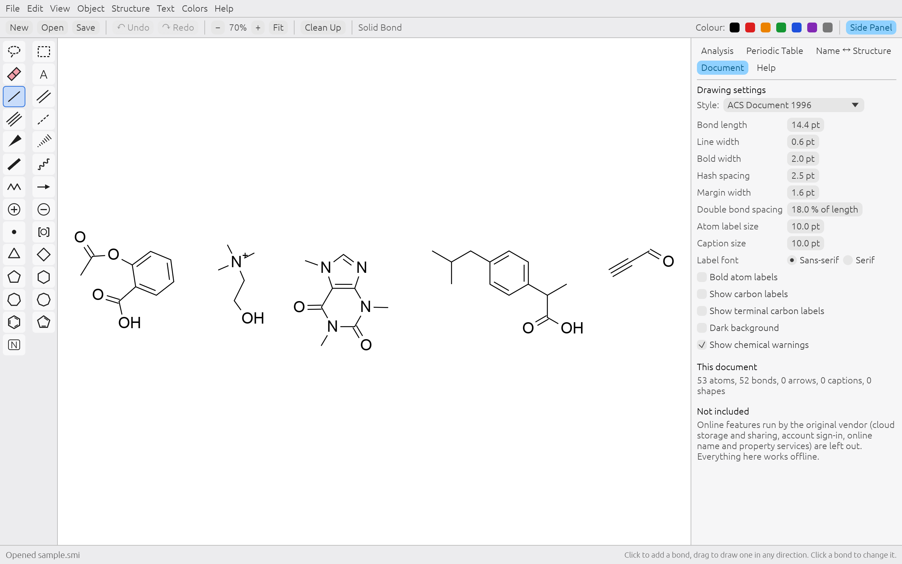

## Download

Get the installer for your computer from the
**[latest release](https://github.com/Komnin1/formula/releases/latest)**:

| Your computer | File |
|---|---|
| Mac (Apple silicon or Intel, macOS 11+) | `Formula-<version>.dmg` |
| Windows 10/11, 64-bit | `Formula-Setup-<version>.exe` |
| Windows, 32-bit | `Formula-Setup-<version>-x86.exe` |
| Linux x86-64 (Debian 12+, Ubuntu 22.04+) | `formula_<version>_amd64.deb` |
| Linux ARM64 (e.g. Raspberry Pi 4/5) | `formula_<version>_arm64.deb` |

The release page explains how to open the app the first time on each system. To build it
yourself, see [BUILD.md](BUILD.md).

## What it does

### Drawing

- Single, double, triple, wedged, hashed, bold, dashed and wavy bonds; atom labels,
  charges and radicals.
- Rings (3- to 8-membered, benzene, cyclohexane chairs) and zig-zag chains of any length.
- 56 arrow styles: reaction, equilibrium (balanced and unbalanced), retrosynthetic, hollow,
  half-headed, curved (electron-pushing) and rotation arrows, plus "no-go" crosses.
- Shapes, brackets, text and captions with sub- and superscripts; colours; frames.
- Templates: L- and D-amino acids, aromatics, cycloalkanes and conformers, hexoses and
  pentoses (Fischer, Haworth, chair), nucleic bases, DNA and RNA nucleotides.
- Hot keys for fast structure editing: point at an atom or bond and press a key to change it
  or grow the structure from it. For example, "2" adds a carbonyl, "o" an OH group, "n" an
  NH₂ group, "6" a six-membered ring and "j" a cyclohexane chair. The full list is in
  Help ▸ Hotkeys Cheat Sheet.
- Structure clean-up (Structure ▸ Clean Up Structure): evens out the bond lengths and angles
  of the selected structures, or of the whole drawing.
- Aligning and distributing objects: line up structures, arrows, captions and shapes by
  their left, right, top or bottom edges or by their centres, and space them evenly or with
  a fixed gap. Objects can also be flipped and rotated, with rulers and a grid to help.
- Scale selected structures with Object ▸ Scale… or the corner handles: bond lengths, line
  widths, labels and captions change together, and the size is saved in the file.
- Group labels such as CO2Me, NHBoc or PPh3 are understood chemically, and written-out
  hydrogen counts update as bonds are added.
- Isotope labels (¹³C, ¹⁵N, ²H/D, ¹⁸O, …) by right-click, menu or typing "13C" in a label.
- Structure checking marks atoms with impossible valences.
- Automatic recovery: unsaved work is kept if the program stops unexpectedly.

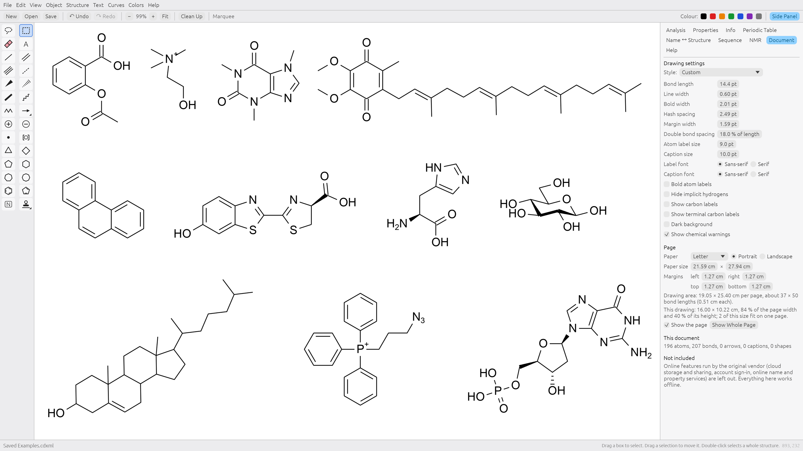

These structures are in [examples/Examples.cdxml](examples/Examples.cdxml); open it in Formula to try
the analysis, NMR and naming tools.

### Styles and pages

- 21 built-in document styles modelled on common journal formats (ACS 1996, Wiley,
  Nature Research, RSC 1- and 2-column, Synthesis/Synlett, Adv. Synth. Catal., J. Het. Chem.,
  Helv. Chim. Acta and others), plus Dark Mode.
- Adjustable bond length, line and bold widths, hash and double-bond spacing, label and
  caption fonts and sizes.
- Page size (Letter, A4 or custom, portrait or landscape) with margins, shown on the canvas.

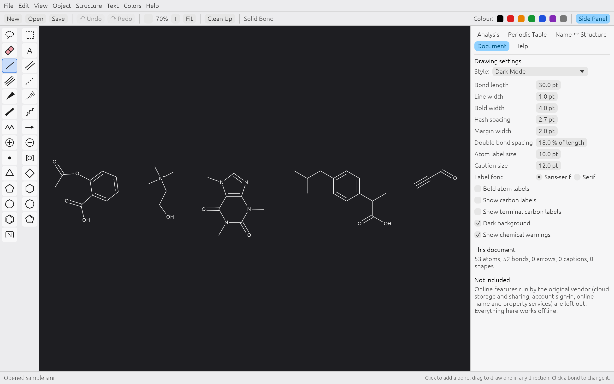

### Analysis

- Molecular formula, exact mass, molecular weight and elemental analysis, for the whole
  drawing or the selection; paste them into the drawing as text.
- Isotopic distribution of the ion, shown as an m/z list and as a predicted mass spectrum
  with a peak table. Cations and anions (also multiply charged) are shown as drawn; neutral
  molecules as [M+H]⁺.
- Estimated properties: boiling and melting point, critical constants, heats of formation,
  log P, molar refractivity, polar surface area, H-bond donors/acceptors, rotatable bonds.
- Periodic table with element data.

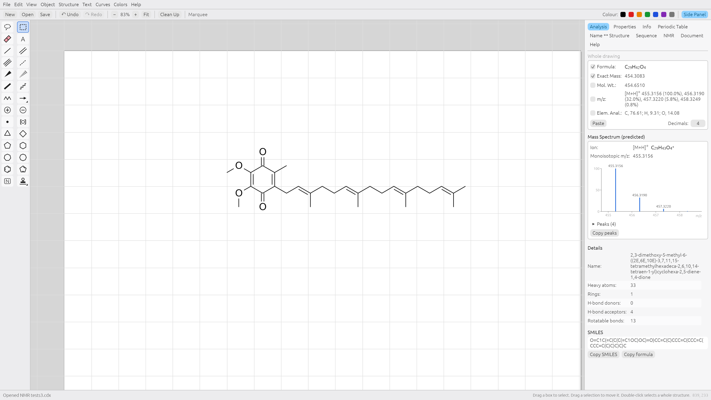

### NMR prediction

- ¹H, ¹³C, ¹⁹F, ³¹P and ¹⁵N chemical shifts, predicted offline from standard increment
  rules, with corrections learned from published spectra.
- Multiplicities and coupling constants (H–H, and couplings to P, F, ¹³C, ¹⁵N and D).
- Stick spectrum at 300–800 MHz with the solvent peak, a peak table, and shifts written next
  to the atoms; hover a peak to see its atoms.
- Copy the peak list as text in the common experimental-section style (close to ACS), e.g.
  "¹H NMR (predicted, 400 MHz, CDCl₃) δ 4.10 (q, J = 7.0 Hz, 2H), …".
- Isotope labels (¹³C, ¹⁵N, ²H) are taken into account, including partial enrichment.

  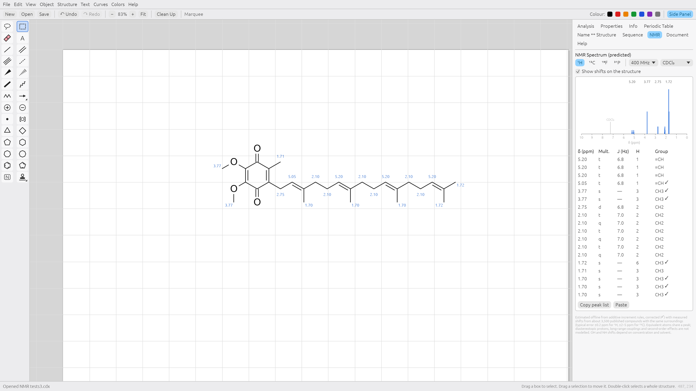
  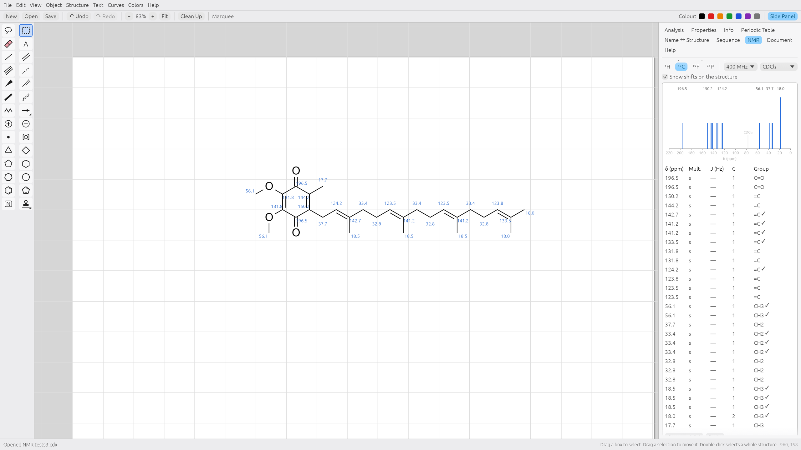

### Names and structures

- **Name-to-structure conversion (and vice versa).** Systematic IUPAC names are generated
  for most drawn structures. *R*/*S* and *E*/*Z* descriptors are supported. About 300
  well-known compounds (drugs, vitamins, natural products, reagents) also get their trivial
  names.
- Paste or type SMILES, Molfile or CDXML text to get a structure; copy SMILES out.

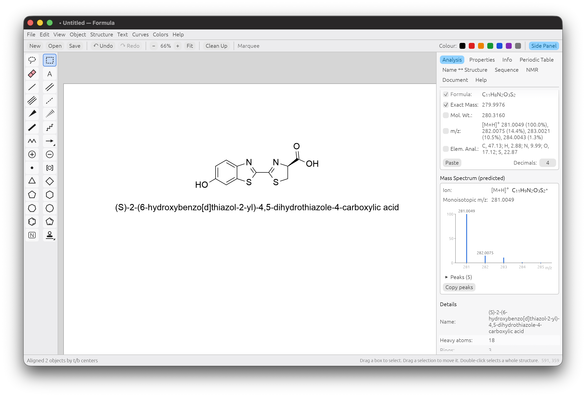

### Biopolymers

- Protein, DNA and RNA sequences: FASTA import, complement and reverse complement,
  transcription (DNA → RNA), back-transcription (RNA → DNA), translation (RNA → protein),
  formulas and masses.
- Peptides with D-amino acids (lower-case letters) and cyclic peptides drawn as full
  structures or as HELM-style monomer circles.
- HELM biopolymers in CDX/CDXML files open as coloured monomer shapes.

  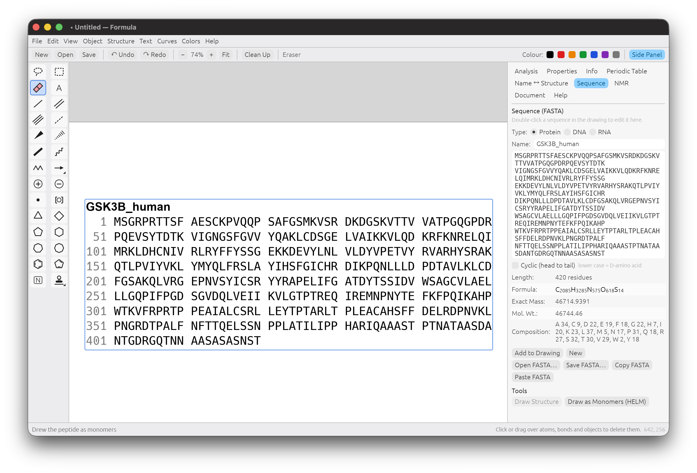
  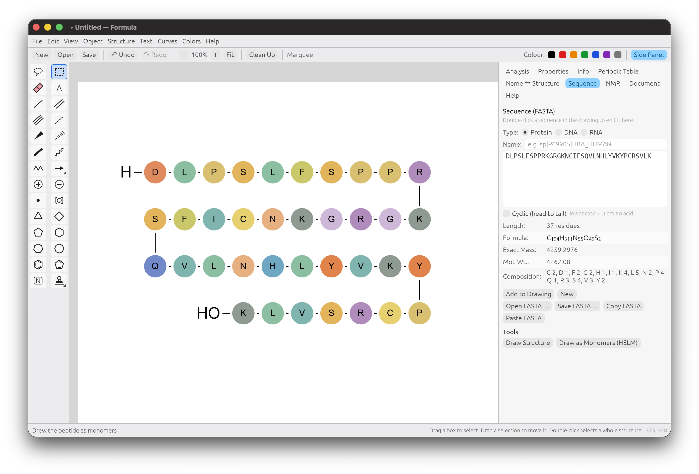

  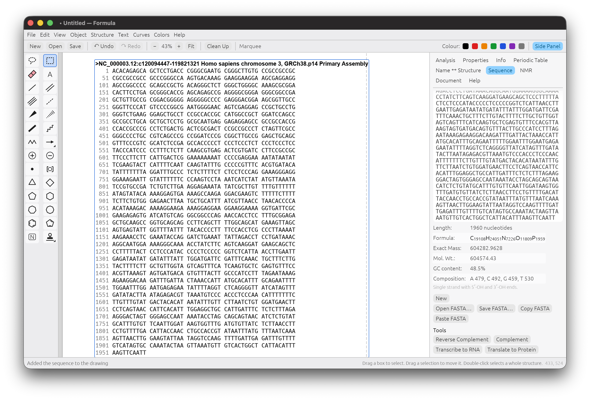
  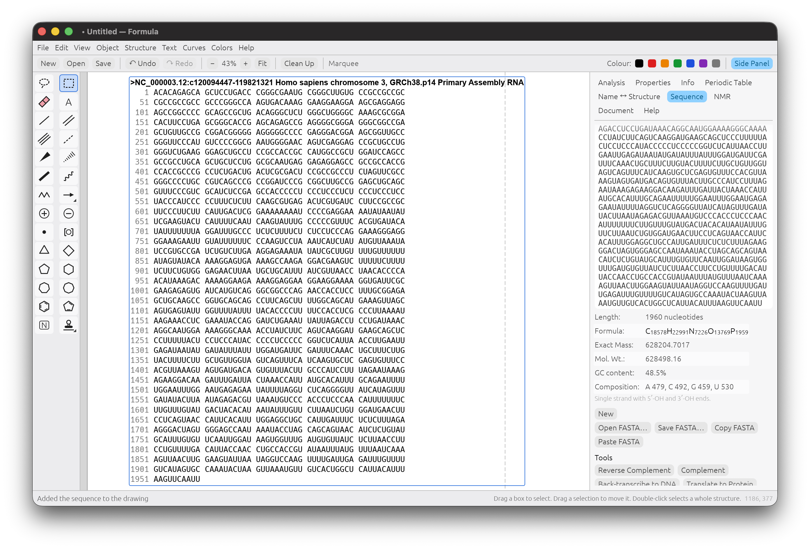

### Files

- **Open and save:** CDX and CDXML (.cdx, .cdxml, .ctp), Molfile V2000/V3000, SDfile,
  RXN V2000/V3000, CML, SMILES and FASTA. Data Formula doesn't use in a CDX/CDXML file is
  kept and written back on save.
- **Export:** PDF, EPS, SVG, PNG, JPEG, GIF, BMP and TIFF.

### Working with Word and other programs

- Mac and Windows: copy a drawing and paste it as a picture into Word, PowerPoint and other
  programs. The structure travels inside the picture, so copying it back into Formula makes
  it editable again.
- Windows: structures paste into Word, PowerPoint, Excel and LibreOffice as editable
  objects. Double-click one to edit it in Formula; closing Formula puts the changes back.
- Linux: Copy puts a picture (PNG, about 300 dpi) on the clipboard under X11 and Wayland,
  so LibreOffice and other programs paste a picture; pasting it back into Formula gives the
  structure again.

Labels use the Arial and Times New Roman fonts installed with macOS and Windows; on other
systems Formula uses its built-in font.

## Build from source

    cargo build --release
    ./target/release/formula [file]

Installers for each system are built with the scripts in `installer/`; see
[BUILD.md](BUILD.md).

## How it was made

Formula was written from scratch without access to the code, files or
resources of any other chemistry program: no other program's files were
opened, decompiled or copied while building it. File formats were implemented
from publicly documented descriptions and general chemistry knowledge. Some
details (for example a few binary style tags and the numbers behind the journal
style presets) are best guesses and may differ from other programs.

## Trademarks

Formula is an independent project and is not affiliated with, endorsed by or
sponsored by any chemistry software company or scientific publisher. File
format and journal names appear only to describe compatibility and remain the
property of their owners.

## License

MIT; see LICENSE. Third-party libraries are listed in THIRD-PARTY.md.
